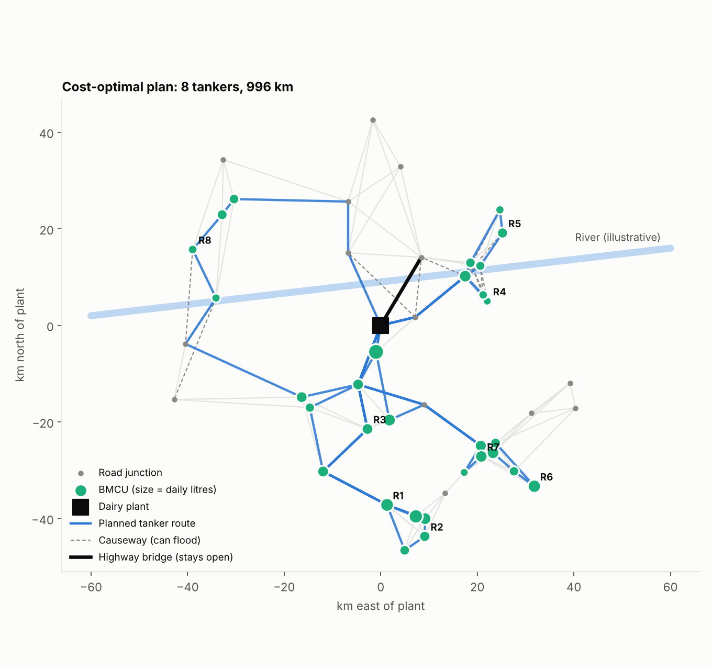
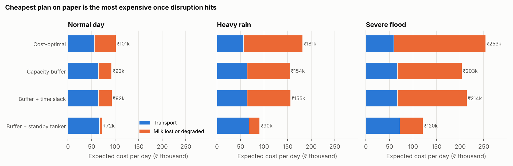
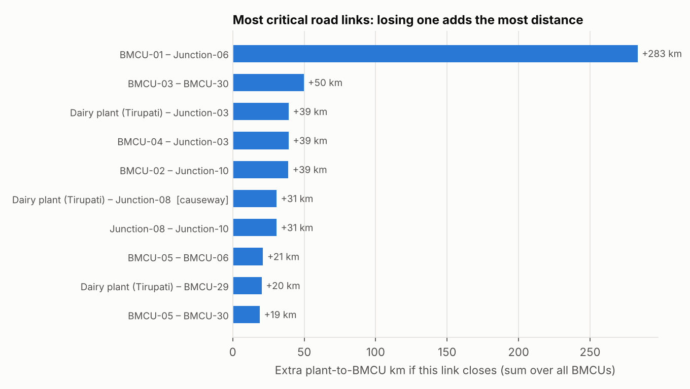
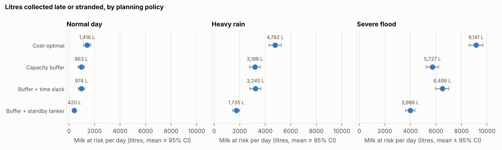

# Resilient milk collection routing for Bulk Milk Cooling Units (BMCUs)

**Optimisation, network analysis and disruption simulation for a rural dairy supply chain**

[](https://bmcu-milk-routing.streamlit.app)  **Try it in your browser, nothing to install:** https://bmcu-milk-routing.streamlit.app

Village Bulk Milk Cooling Units (BMCUs) chill farmers' milk until an insulated tanker collects it and brings it to the dairy plant. The milk must be collected within its quality window, every tanker has a fixed capacity, and rural roads, especially low causeways, close in heavy rain. This project plans the daily tanker routes, finds the road links the network depends on most, and tests how each plan holds up when disruption hits.

The setting is an illustrative network of 30 BMCUs around a dairy plant near Tirupati, Andhra Pradesh. **All data is synthetic** (see [Assumptions](#assumptions-and-limitations)).



## Key findings

1. **The cheapest plan on paper is the most expensive in practice.** The cost-optimal plan needs only 8 tankers (₹55,900/day planned), but fills them to 99% of capacity. Normal day-to-day variation in milk volume then leaves milk stranded on **79% of days**. Once lost and degraded milk is counted, its expected daily cost is ₹100,600.
2. **A standby tanker is the best policy in every scenario.** It means keeping one tanker on call to recover milk that the planned routes miss. It cuts days with stranded milk to **2% or fewer**, even in a severe flood. Expected daily cost falls from ₹253,000 to ₹120,000 in a severe flood (−53%) and from ₹100,600 to ₹71,800 on a normal day (−29%).
3. **A capacity buffer helps, but not enough on its own.** Planning tankers to 85% of capacity adds one tanker (+₹8,700/day transport). It cuts stranded-milk days on a normal day from 79% to 11%, but still leaves milk stranded on 32–39% of rain and flood days, mostly after breakdowns.
4. **Extra time slack adds nothing here.** This is an honest negative result. Planning with travel times inflated by 25% produced almost the same plan and no better outcomes, because **capacity, not time, is the binding constraint** in this network.
5. **One road link is a single point of failure for a whole cluster.** Closing the link between BMCU-01 and Junction-06 adds 283 km to the plant-to-BMCU network, five times more than any other link. It is the first candidate for priority maintenance or a second access road.



## Method

The project combines three operations research methods, each in its own module.

| Layer | Method | Tools | Module |
|---|---|---|---|
| Network analysis | Road network graph; shortest paths; edge betweenness; single-link removal (vulnerability) | NetworkX | `network.py` |
| Optimisation | Capacitated vehicle routing with time windows (CVRPTW): exact MILP and a heuristic for the full network | PuLP + HiGHS, Google OR-Tools | `milp.py`, `routing.py` |
| Simulation | Discrete-event simulation of a collection day under disruption, with 500 replications per scenario and policy | SimPy, NumPy | `simulation.py`, `experiment.py` |

### 1. Network analysis
Each node (the plant, 30 BMCUs, 14 road junctions) links to its 4 nearest neighbours, plus a minimum spanning tree so that every node is connected. Road length is straight-line distance × 1.30 circuity. Links that cross the river are **causeways** that can close. The crossing nearest the plant is a **highway bridge** that always stays open. Each link is scored on three measures:
- **betweenness:** how many plant-to-BMCU shortest paths use it
- **extra km:** how much total distance grows if the link closes
- **cut-off:** how many BMCUs become unreachable



### 2. Optimisation
**Exact model (two-index MILP).** Decision variables: x<sub>ij</sub> = 1 if a tanker drives from stop i to j; t<sub>i</sub> = collection start time; q<sub>i</sub> = load after stop i.

- **Objective:** minimise fixed cost × tankers used + cost per km × km driven
- **Visits:** each BMCU is entered and left exactly once; at most K tankers are used
- **Time:** t<sub>j</sub> ≥ t<sub>i</sub> + service<sub>i</sub> + travel<sub>ij</sub> − M(1 − x<sub>ij</sub>)
- **Quality windows:** ready<sub>i</sub> ≤ t<sub>i</sub> ≤ deadline<sub>i</sub>
- **Return:** tankers are back at the plant by closing time
- **Load:** q<sub>j</sub> ≥ q<sub>i</sub> + demand<sub>j</sub> − Q(1 − x<sub>ij</sub>), with q<sub>i</sub> ≤ Q (this also rules out sub-tours)

**Heuristic.** OR-Tools with guided local search solves the same problem for all 30 BMCUs.

**Validation.** On instances of 7–10 BMCUs, the heuristic matches the proven MILP optimum exactly (0.0% gap). The MILP's solve time grows from 0.3 s to 21.5 s over that range, which is why the full network uses the heuristic.

### 3. Simulation
Routes are fixed in the morning, and then each simulated day unfolds:

- **Road closures:** each causeway closes with a scenario probability; tankers re-route on the open roads.
- **Travel:** times slow down by a scenario factor, with random noise on every leg.
- **Volumes:** BMCU volumes differ from plan (lognormal noise).
- **Breakdowns:** a tanker can break down part-way through its route.
- **Missed milk:** milk a tanker cannot collect (no room, unreachable, breakdown) becomes a recovery request. A standby tanker serves the requests first come, first served; without one, that milk is stranded for the day.

| Scenario | Travel time × | Causeway closure | Breakdown / tanker |
|---|---|---|---|
| Normal day | 1.0 | 0% | 2% |
| Heavy rain | 1.3 | 35% | 4% |
| Severe flood | 1.5 | 80% | 6% |

**Policies compared:**
- **P0 Cost-optimal:** the cheapest plan on a normal day
- **P1 Capacity buffer:** plan to 85% of tanker capacity
- **P2 Buffer + time slack:** P1, planned with travel times inflated by 25%
- **P3 Buffer + standby tanker:** P1, plus one tanker on call

Within each replication, every policy faces the same closures and volumes (common random numbers), so the comparisons are fair. A test checks that every litre is accounted for (on time + late + stranded = total) in every simulated day.

**Cost** = transport (fixed + per km + overtime + standby retainer) + value of stranded milk + 30% value loss on milk collected after its quality window.



Full tables: [`outputs/results.md`](outputs/results.md). Raw results for all 6,000 simulated days: `outputs/simulation_runs.csv`.

## Assumptions and limitations

- **Synthetic data.** BMCU locations, volumes, quality windows, costs and disruption probabilities are illustrative assumptions (all in `src/bmcu/config.py`), not data from any dairy. The results show the method and the direction of the trade-offs, not real costs.
- **Proxy road network.** Links are generated from geometry, not from an actual road map. A real study would use OpenStreetMap road data (e.g. via OSMnx) and observed closure records.
- **One collection run per day** (morning milk). Many BMCUs are collected twice daily.
- **Standby dispatch** is first come, first served. A smarter dispatch rule (e.g. re-optimising when a request arrives) would likely do better.
- **The heuristic uses a time limit**, so plans can vary slightly between runs.
- Disruption probabilities are not estimated from data. A next step is to calibrate them against road closure and breakdown records, and to validate the model with dairy procurement staff.

## How this transfers to emergency fuel supply

The same structure applies to keeping diesel flowing to critical customers after a disaster:

| Milk collection | Emergency diesel supply |
|---|---|
| BMCU with a quality window | Critical customer (hospital, telecom site, water plant) with hours of backup fuel |
| Insulated milk tanker | Fuel tanker |
| Causeway that floods | Road link damaged by an earthquake, flood or cyclone |
| Capacity buffer | Prepositioned stock / spare delivery capacity |
| Standby tanker | Support from commercial operators or the Defence Force |
| Litres stranded or late | Unmet critical demand |

## Interactive app

**Online:** open https://bmcu-milk-routing.streamlit.app. If the app has been idle it shows a "wake up" button first and takes about a minute to start.

**On your own machine:**

```bash
pip install -r requirements.txt
streamlit run app.py
```

Your browser opens the app. Set the fleet (tankers, capacity, speed, return time), the disruption (flooding,
breakdowns, slower roads, volume swings), the policy buffers and the costs, then press **Run model**. A run
takes 15 to 30 seconds. The app uses exactly the same routing, network and simulation code as `run_all.py`.
"Fast" planning uses a 3-second search per plan, so its plans can cost slightly more than the full run's.

## Run it

```bash
pip install -r requirements.txt   # needs Python 3.10 or newer
python run_all.py --quick   # about 1.5 minutes, 50 replications
python run_all.py           # about 4 minutes, 500 replications (the results above)
python -m pytest -q         # sanity tests
```

## Project structure

```
app.py                     interactive app (streamlit run app.py)
run_all.py                 full pipeline: scenario -> network -> optimisation -> simulation -> results
src/bmcu/config.py         every assumption and parameter in one place
src/bmcu/scenario.py       illustrative BMCU network generator
src/bmcu/network.py        road graph, shortest paths, link criticality
src/bmcu/instance.py       routing instance + route checker
src/bmcu/milp.py           exact CVRPTW (PuLP + HiGHS)
src/bmcu/routing.py        OR-Tools heuristic for the full network
src/bmcu/simulation.py     SimPy discrete-event simulation of a disrupted day
src/bmcu/experiment.py     policies x scenarios experiment, summary statistics
src/bmcu/plots.py          figures
tests/test_models.py       heuristic vs exact, milk conservation
data/                      generated nodes and road links
outputs/                   plans, criticality, simulation results, figures
```

## Author
Ganesh Darapureddi · B.Tech Dairy Technology (SVVU Tirupati) · PGDM Finance & Business Analytics · Executive Programme in Business Analytics & AI (IIM Bangalore)
